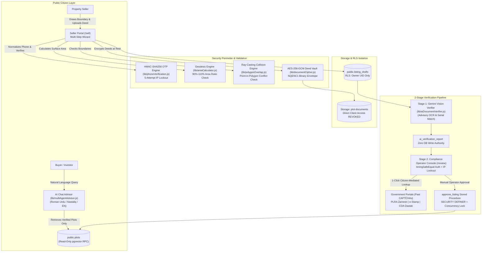
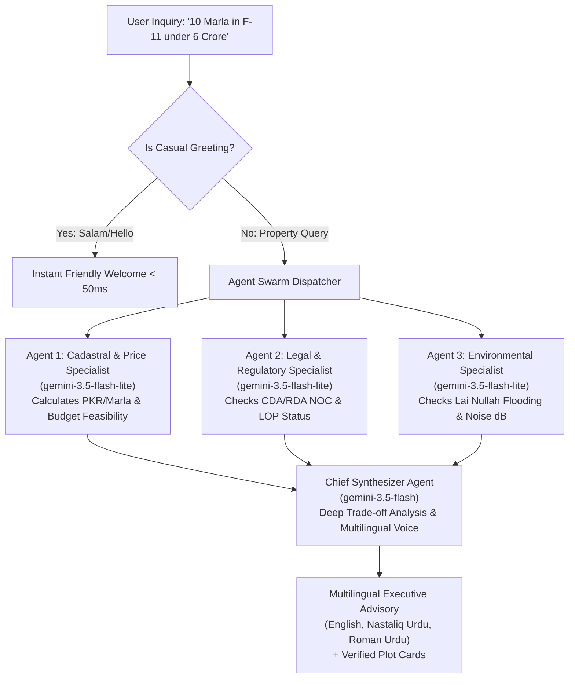

# NAQSHAI — Master Project Context & AI Onboarding Dossier

> **INSTRUCTION FOR AI ASSISTANTS:**  
> This document is the **single source of truth** for the NAQSHAI codebase. It contains the complete architectural, mathematical, cryptographic, security, database, and operational context of the project. Read this entire document before answering questions, generating code, proposing refactors, or modifying files in this repository.

---

## 1. Executive Identity & System Mission

* **Project Name:** NAQSHAI (نقشہ / Naqsha = Map/Blueprint in Urdu)
* **Tagline:** Institutional Cadastral Intelligence & Land Record Verification Infrastructure
* **Target Jurisdiction:** Islamabad Capital Territory (CDA Zones 1–5) & Rawalpindi District (RDA / PLRA Punjab Zameen / Punjab e-Stamp)
* **Live Deployment:** [https://naqshaii.vercel.app/](https://naqshaii.vercel.app/)
* **Founding & Engineering Team:** Hassan (Muhammad Hassan Farooq), Ahsan Hayat, alizy51125
* **Chronological Span:** August 20, 2026 – November 7, 2026 (79 Days | 137 Commits | 32,344 Net Production Code Lines)
* **Quality & Test Status:** 5 Automated Test Suites | 217 / 217 Passing Assertions (100% Pass Rate)

### The Core Problem Solved
Conventional Pakistani property portals (Zameen.com, Graana, OLX) operate as **unverified classifieds billboards**. They monetize listing volume, not transactional integrity. Consequently:
1. **Non-Balloted Files:** Societies print 50,000 speculative "paper files" with land for only 10,000 on-ground plots. Buyers pay installments for 5+ years without a physical parcel allocated.
2. **Boundary Encroachment (*Zameen Qabza*):** Sellers claim 10 Marla on paper but fence off 13 Marla on ground to steal CDA green belts or access roads. When the CDA/RDA anti-encroachment wing strikes, buyers face demolition.
3. **Duplicate Registries:** Historic paper registers (*Latha / Jamabandi*) held by local *Patwaris* allowed the same plot to be sold to multiple buyers using duplicate stamp papers.
4. **Overseas Remittance Risk:** Non-Resident Pakistanis (NRPs) remit over \$30 Billion annually to Pakistan, with 25–30% channeled into real estate. Unable to visit physically, they bear the brunt of forged file scams.
5. **Walled Government Registries:** Official land records (PLRA Punjab Zameen, Punjab e-Stamp, CDA Dastak) sit behind strict reCAPTCHAs and offer zero public developer REST APIs.
6. **The Autonomous AI Trap:** Giving an LLM autonomous write access to approve uploaded property deeds invites **adversarial document prompt injection** (e.g. white-on-white text in PDFs commanding the model to approve fake land).

### How NAQSHAI Solves It
NAQSHAI replaces naive classifieds pins with **mathematically verified cadastral polygons** (WGS84 ellipsoidal surface area math + ray-casting collision detection), **AES-256-GCM encrypted deed vaults**, and a **2-Stage Human-in-the-Loop (HITL)** verification engine that equips human compliance officers with 1-click citizen-mediated deep links to verify government records past CAPTCHAs in under 10 seconds.

---

## 2. Core Tech Stack & Dependencies

```
┌────────────────────────────────────────────────────────────────────────┐
│                        NAQSHAI TECHNOLOGY STACK                        │
├───────────────────┬────────────────────────────────────────────────────┤
│ Frontend Web      │ Next.js 16.3.3 (App Router), React 19.2.8,         │
│ Framework         │ Tailwind CSS v4 (@tailwindcss/postcss)             │
├───────────────────┼────────────────────────────────────────────────────┤
│ Geospatial & Maps │ Google Maps JavaScript API (@react-google-maps/api)│
│                   │ Places Autocomplete, Street View 360, WGS84 Geodesy│
├───────────────────┼────────────────────────────────────────────────────┤
│ Artificial        │ Google Gen AI SDK (@google/genai v2.19.0)          │
│ Intelligence      │ Models: gemini-3.5-flash-lite (fast workers),      │
│                   │ gemini-3.5-flash (synthesizer/vision OCR)          │
├───────────────────┼────────────────────────────────────────────────────┤
│ Database & Vector │ Supabase PostgreSQL (@supabase/supabase-js v2.112) │
│ Engine            │ pgvector extension with HNSW Cosine Index          │
├───────────────────┼────────────────────────────────────────────────────┤
│ Cryptography &    │ Node crypto: AES-256-GCM envelope encryption,      │
│ Security          │ HMAC-SHA256 tokens, timingSafeEqual, CSPRNG OTPs   │
├───────────────────┼────────────────────────────────────────────────────┤
│ Icons & Visuals   │ Lucide React (lucide-react v1.37.0)                │
└───────────────────┴────────────────────────────────────────────────────┘
```

> [!IMPORTANT]
> **Strict Library Discipline:** Use **only** installed packages (`@google/genai`, `@react-google-maps/api`, `@supabase/supabase-js`, `lucide-react`). Do **not** hallucinate or attempt to install unapproved npm packages. All path imports must use the `@/...` root alias.

---

## 3. High-Level Architecture & The 2-Stage HITL Pipeline

NAQSHAI operates on the absolute architectural invariant: **Zero Autonomous AI Authority**. AI provides observational intelligence and multimodal OCR extraction; actual database write authority and publication require human operator sign-off.



---

## 4. Key Architectural Engines & Mathematical Modules

### 4.1 Cadastral Surface Area Calculation Engine (`lib/areaCalculator.js`)
* **Purpose:** Calculates real-world surface area of seller-drawn polygon perimeters on the WGS84 authalic ellipsoid using spherical excess geometry.
* **Pakistani Cadastral Standards:**
  * 1 Marla = **225 sq ft** (CDA Islamabad standard: 25×50 ft = 1,250 sq ft for 5 Marla).
  * 1 Kanal = **20 Marla** = **4,500 sq ft**.
  * 1 sq meter = **10.7639 sq ft**.
* **Anti-Encroachment Boundary Rule:** Compares drawn polygon surface area against declared plot size. Strictly enforces an area ratio between **90% and 110%** (`MIN_AREA_MATCH_RATIO = 0.90`, `MAX_AREA_MATCH_RATIO = 1.10`).
  * If drawn land < 90%: Flagged as `UNDERSIZED_DEFECTIVE`.
  * If drawn land > 110%: Flagged as `OVERSIZED_ENCROACHMENT_RISK`.

### 4.2 Spatial Overlap & Boundary Collision Engine (`lib/polygonOverlap.js`)
* **Purpose:** Prevents double-allotment and boundary conflict fraud by verifying that a newly submitted polygon does not overlap with any previously approved or registered parcel.
* **Mathematics:** Implements the **Ray-Casting Algorithm** (Jordan Curve Theorem) to determine point-in-polygon containment and line-segment bounding-box intersection.

### 4.3 Environmental & Disaster Risk Engine (`lib/environmentalMetrics.js`)
* **Purpose:** Evaluates hydrological and noise hazards for Islamabad and Rawalpindi plots based on coordinate centroids:
  * **Monsoon Flood Risk:** Computes radial proximity to Rawalpindi's **Lai Nullah** catchment corridor and CDA seasonal flood channels. Assigns risk tier (`Low`, `Moderate`, `High`) and setback requirements.
  * **Geospatial Noise Level (dB):** Calculates ambient noise score (45–85 dB) based on proximity to major arterials (Islamabad Expressway, Kashmir Highway / Srinagar Highway, GT Road, Murree Road).
  * **Elevation & Topography:** Computes terrain slope and foundation excavation hazard (*bhrati zameen* / filled land).

### 4.4 Regulatory & Authority Clearance Registry (`lib/regulatoryRegistry.js`)
* **Curated Regulatory Knowledge Base:** Official gazetted datasets covering:
  1. *CDA Zone 1 Municipal Sectors:* F-6, F-7, F-8, G-9, G-11, I-8, D-12, etc. (Direct CDA One-Window transfer).
  2. *CDA Approved Private Societies:* Multi Gardens B-17, Faisal Hills, D-17, etc. (Valid NOC & approved Layout Plan / LOP).
  3. *RDA Approved Schemes:* Bahria Town Rawalpindi, Top City, etc.
  4. *Illegal / Unapproved Housing Schemes:* Ghauri Town, Blue World City non-NOC phases, Park View illegal extensions (with official gazette warnings and litigation notes).

---

## 5. Security & Cryptography Architecture (Zero-Trust)

NAQSHAI enforces a military-grade zero-trust perimeter across five layers:

```
┌────────────────────────────────────────────────────────────────────────┐
│                     NAQSHAI DEFENSE-IN-DEPTH MATRIX                    │
├───────────────────┬────────────────────────────────────────────────────┤
│ 1. Deed Vault     │ AES-256-GCM envelope encryption at rest. Scanned   │
│    (lib/document- │ deeds get 4-byte NQENC1 header, 96-bit random IV, │
│     Cipher.js)    │ and 128-bit authentication tag. Storage bucket has │
│                   │ ALL direct public/anon client access revoked.      │
├───────────────────┼────────────────────────────────────────────────────┤
│ 2. Operator Auth  │ Constant-time bitwise string comparison            │
│    (lib/auth-     │ (timingSafeEqual) on bearer passphrases. Eliminates│
│     Server.js)    │ early-exit timing side-channels. Sliding-window    │
│                   │ IP rate limiter (5 failed attempts = 15m lockout). │
├───────────────────┼────────────────────────────────────────────────────┤
│ 3. DB Lockdown    │ 07_lock_down_plot_writes.sql revokes all INSERT,   │
│    (PostgreSQL)   │ UPDATE, DELETE on public.plots. Publishing is      │
│                   │ permitted ONLY through atomic RPC approve_listing  │
│                   │ (SECURITY DEFINER with SELECT ... FOR UPDATE).     │
├───────────────────┼────────────────────────────────────────────────────┤
│ 4. RAG Prompt     │ Untrusted user messages encapsulated within XML    │
│    Injection      │ tags (<untrusted_user_query>). System instructions │
│    Containment    │ strictly isolate data from commands.               │
├───────────────────┼────────────────────────────────────────────────────┤
│ 5. Contact        │ Raw seller phone numbers are NEVER placed inside   │
│    Privacy        │ the LLM prompt context (masked as [Protected]).    │
│    Masking        │ Numbers are enriched out-of-band in Node code      │
│                   │ directly onto client cards for WhatsApp actions.   │
└───────────────────┴────────────────────────────────────────────────────┘
```

### The 5 RAG Security Principles in NAQSHAI
1. **Access Control During Retrieval:** The conversational RAG pipeline queries `public.plots` where `is_verified = true`. Unapproved drafts and unverified files are never retrieved into context.
2. **Retrieved Content Treated as Untrusted Data:** Scanned deed text and user queries are treated as untrusted data inputs, never as model instructions.
3. **Separation of Instructions from Evidence:** Queries and evidence are strictly delimited via XML containers (`<untrusted_user_query>`, `<untrusted_document_evidence>`).
4. **Zero Autonomous Actions:** Retrieved documents and AI recommendations can never independently mutate database rows or trigger external API writes.
5. **Adversarial Test Suite:** Continuous testing via `scripts/test-adversarial-prompt-injection.mjs` ensuring injection attempts fail to alter system behavior or leak credentials.

---

## 6. Generative AI & Autonomous Multi-Agent Swarm

### 6.1 Multi-Agent Architecture (`lib/multiAgentAdvisor.js`)
When a buyer submits a real estate query, NAQSHAI runs a **parallelized multi-agent swarm**:



### 6.2 Vector Similarity Search (pgvector)
* **Embedding Model:** Google Gen AI embedding (`text-embedding-004`).
* **Index Strategy:** Hierarchical Navigable Small World (**HNSW**) cosine distance index (`02_vector_hnsw_index.sql`).
* **Stored Procedure:** `match_plots(query_embedding vector(768), match_threshold float, match_count int)`.

---

## 7. Complete Directory Map & Key Files

```
naqshai/
├── app/                                 # Next.js App Router root
│   ├── layout.js                        # Root HTML shell with Navbar, Footer & Global Contexts
│   ├── page.js                          # Landing Page ("Refined Architectural Light" hero)
│   ├── explore/                         # /explore: 3D interactive map, filters, plot drawer
│   ├── sell/                            # /sell: Citizen listing wizard (polygon drawing + deed upload)
│   ├── review/                          # /review: Secure compliance operator verification console
│   ├── recommend/                       # /recommend: Conversational AI advisor interface
│   ├── favorites/                       # /favorites: User bookmarked properties
│   └── api/                             # Serverless API routes
│       ├── chat/route.js                # Multi-Agent Swarm & RAG conversational endpoint
│       ├── review/                      # Operator approval & rejection endpoints
│       │   ├── list/route.js            # Fetches unreviewed listing drafts (operator authenticated)
│       │   ├── approve/route.js         # Calls atomic RPC approve_listing
│       │   └── reject/route.js          # Rejects draft with formal compliance notes
│       ├── documents/                   # Deed Vault streaming & access token generator
│       ├── auth/phone/                  # E.164 normalization, OTP generation & verification
│       ├── sell/draft/                  # Autosaving listing drafts state machine
│       └── analytics/track/             # Privacy-friendly visitor & Panaflex QR tracking
│
├── components/                          # Modular React UI components
│   ├── Navbar.js                        # Responsive top navigation with status indicators
│   ├── Footer.js                        # Institutional footer with CDA/RDA compliance notices
│   ├── explore/                         # Map explorer subcomponents
│   │   ├── InteractiveMap.js            # Google Maps JS container, polygons & markers
│   │   ├── PlotDetailsDrawer.js         # Slide-out property inspection drawer
│   │   ├── FilterBar.js                 # Budget, size, city, and verification filters
│   │   └── StreetViewPanorama.js        # Google Maps Street View 360 viewer
│   ├── Review/                          # Operator review subcomponents
│   │   ├── DraftVerificationTable.js   # Tabular review queue with 1-click government links
│   │   ├── AiReportViewer.js            # Multimodal Gemini Vision OCR inspector
│   │   └── AuditLogsDrawer.js           # Immutable access and modification log viewer
│   └── SiteAnalyticsTracker.js          # Visitor beacon & attribution handler
│
├── lib/                                 # Core mathematical, security & AI engines
│   ├── areaCalculator.js                # Geodesic WGS84 surface area calculator (90-110% ratio)
│   ├── polygonOverlap.js                # Ray-casting point-in-polygon boundary collision engine
│   ├── documentCipher.js                # AES-256-GCM envelope encryption & HMAC token generator
│   ├── authServer.js                    # Server-side auth & timingSafeEqual constant-time matching
│   ├── multiAgentAdvisor.js             # Autonomous Multi-Agent Swarm (Workers + Synthesizer)
│   ├── aiDocumentVerifier.js            # Gemini Vision OCR deed analysis (Stage 1 HITL)
│   ├── environmentalMetrics.js          # Lai Nullah monsoon flood risk & noise level calculations
│   ├── regulatoryRegistry.js            # CDA Zone 1-5, RDA NOC & illegal society gazette datasets
│   ├── phoneVerification.js             # E.164 phone normalization & CSPRNG OTP challenge generator
│   ├── operatorRateLimiter.js           # Sliding-window IP lockout engine for /review
│   └── supabaseClient.js                # Client and server Supabase SDK initializers
│
├── supabase/migrations/                 # 15 PostgreSQL migration scripts (01 to 15)
│   ├── 01_schema.sql                    # Base public.plots table & PostGIS/pgvector extensions
│   ├── 02_vector_hnsw_index.sql         # HNSW cosine index on plot embeddings & match_plots RPC
│   ├── 07_lock_down_plot_writes.sql     # Revokes direct INSERT/UPDATE/DELETE on public.plots
│   ├── 08_atomic_listing_approval.sql   # Atomic approve_listing RPC with row lock
│   ├── 14_document_security_and_access_logs.sql # Audit tables for deed decryptions
│   └── 15_site_visitor_analytics.sql    # Anonymized visitor tracking & QR attribution
│
├── scripts/                             # Test suites & documentation generators
│   ├── test-adversarial-prompt-injection.mjs # 5 RAG security principles injection benchmark
│   ├── test-otp-verification.mjs        # 79 assertions on phone OTP & HMAC tokens
│   ├── test-portal-verification-pipeline.mjs # End-to-end listing-to-publish regression suite
│   ├── test-csp-and-headers.mjs         # Content Security Policy & HTTP header tests
│   ├── build-history-pdf.mjs            # Compiles this project chronicle into presentation PDF
│   └── build-security-pdf.mjs           # Compiles executive security dossier into PDF
│
└── documentation/                       # Architecture, security & historical chronicles
    ├── NAQSHAI_Development_History_and_Idea_Evolution.md # Full 137-commit chronological narrative
    ├── NAQSHAI_Development_History_and_Idea_Evolution.pdf # Compiled presentation-grade PDF (596 KB)
    └── NAQSHAI_Security_Architecture_Dossier.md          # Comprehensive zero-trust security guide
```

---

## 8. Database Schema & Data Models

### 8.1 Primary Tables

#### `public.plots` (Public Verified Map Catalog)
* **Access Policy:** `SELECT` allowed for `anon` and `authenticated`. Direct `INSERT`, `UPDATE`, `DELETE` **strictly revoked**.
* **Columns:**
  * `id` (`uuid`, PK): Unique parcel identifier.
  * `title` (`text`): Listing title (e.g., "10 Marla Residential Plot - Sector F-11/2, Islamabad").
  * `city` (`text`): Islamabad or Rawalpindi.
  * `price_pkr` (`numeric`): Exact price in Pakistani Rupees.
  * `size_dimensions` (`text`): Size notation (e.g., "10 Marla (35x70)").
  * `area_sqft` (`numeric`): Surface area in square feet.
  * `boundary_coordinates` (`jsonb`): Array of `{ lat, lng }` polygon vertices.
  * `center` (`jsonb`): Coordinate centroid `{ lat, lng }`.
  * `category` (`text`): `residential`, `commercial`, `agricultural`.
  * `is_verified` (`boolean`): True only after human compliance officer approval.
  * `verification_badge` (`text`): `CDA Verified`, `RDA Approved`, `PLRA Fard Verified`.
  * `flood_risk` (`text`): `Low`, `Moderate`, `High`.
  * `noise_level` (`numeric`): Ambient decibel score (dB).
  * `amenity_scores` (`jsonb`): Proximity metrics (schools, hospitals, commercial, parks).
  * `embedding` (`vector(768)`): Semantic embedding for pgvector cosine matching.

#### `public.listing_drafts` (Seller Listing Submissions)
* **Access Policy:** RLS enforced. Sellers can view/edit only their own drafts (`auth.uid() = seller_user_id`).
* **Columns:**
  * `id` (`uuid`, PK): Draft ID.
  * `seller_user_id` (`uuid`): Foreign key to Supabase Auth user.
  * `seller_phone` (`text`): Verified E.164 phone number.
  * `status` (`text`): `draft`, `submitted`, `under_review`, `approved`, `rejected`.
  * `boundary_coordinates` (`jsonb`): Drawn polygon vertices.
  * `documents` (`jsonb`): Array of uploaded deed storage paths.
  * `ai_verification_report` (`jsonb`): Advisory OCR analysis from Gemini Vision.
  * `rejection_reason` (`text`): Compliance notes if rejected.

#### `public.plot_document_access_logs` (Deed Vault Audit Ledger)
* **Access Policy:** Immutable audit trail. Only appendable by server roles.
* **Columns:** `id`, `document_path`, `accessed_by_user_id`, `ip_address`, `user_agent`, `access_type`, `created_at`.

---

## 9. Design System: Refined Architectural Light

All UI components in NAQSHAI adhere to the **Refined Architectural Light** design language:

```
┌────────────────────────────────────────────────────────────────────────┐
│               REFINED ARCHITECTURAL LIGHT DESIGN SYSTEM                │
├───────────────────┬────────────────────────────────────────────────────┤
│ Page Canvas       │ bg-slate-100 text-slate-800                        │
├───────────────────┼────────────────────────────────────────────────────┤
│ Cards & Containers│ bg-white border border-slate-200 shadow-sm         │
│                   │ rounded-2xl p-5                                    │
├───────────────────┼────────────────────────────────────────────────────┤
│ Primary Actions   │ bg-emerald-700 hover:bg-emerald-600 text-white     │
│ & Accents         │ font-semibold rounded-xl transition-all            │
├───────────────────┼────────────────────────────────────────────────────┤
│ Trust Badges      │ bg-emerald-50 text-emerald-800 border-emerald-200  │
│ (Verified / Low)  │ (Verified Ownership / CDA Approved / Low Risk)     │
├───────────────────┼────────────────────────────────────────────────────┤
│ Warning Badges    │ bg-amber-50 text-amber-800 border-amber-200        │
│ (Moderate / NOC)  │ (Conditional Review / Pending Land Clearance)      │
├───────────────────┼────────────────────────────────────────────────────┤
│ Danger Badges     │ bg-rose-50 text-rose-800 border-rose-200           │
│ (Illegal / Flood) │ (Unapproved Society / Encroachment Risk / High)    │
└───────────────────┴────────────────────────────────────────────────────┘
```

> [!WARNING]
> **Strict UI Negative Constraint:** Never introduce dark-mode black containers (`bg-black`, `bg-gray-900`) for main layout cards unless explicitly requested. Maintain the bright, institutional, civic-grade light aesthetic.

---

## 10. Operational Runbook & Developer Commands

### 10.1 Running the Application Locally
```powershell
# 1. Install dependencies
npm install

# 2. Configure environment
# Copy .env.example to .env.local and populate credentials
Copy-Item .env.example .env.local

# 3. Start Next.js App Router local development server (port 3000)
npm run dev
```

### 10.2 Executing Automated Security & Pipeline Test Suites
```powershell
# Run adversarial prompt injection & RAG security benchmark (Principle 1-5 tests)
node scripts/test-adversarial-prompt-injection.mjs

# Run phone OTP normalization, CSPRNG & timingSafeEqual test suite (79 assertions)
node scripts/test-otp-verification.mjs

# Run full portal verification pipeline (end-to-end draft -> review -> approve)
node scripts/test-portal-verification-pipeline.mjs

# Run HTTP security headers & CSP conformance suite
node scripts/test-csp-and-headers.mjs

# Run cadastral geodesic area math & tolerance tests
node scripts/test-area-verification.mjs

# Run ray-casting polygon collision overlap tests
node scripts/test-polygon-overlap.mjs
```

### 10.3 Compiling Presentation-Grade Documentation & PDFs
```powershell
# Compiles NAQSHAI Engineering Chronicle & Visual Charts to PDF via Chrome headless
node scripts/build-history-pdf.mjs

# Compiles Comprehensive Security Architecture Dossier to PDF
node scripts/build-security-pdf.mjs
```

---

## 11. Environment Variables Reference (Sanitized)

| Variable | Environment | Required | Functional Purpose |
| :--- | :---: | :---: | :--- |
| `NEXT_PUBLIC_SUPABASE_URL` | Browser & Server | Yes | Supabase PostgreSQL project endpoint URL. |
| `NEXT_PUBLIC_SUPABASE_ANON_KEY` | Browser & Server | Yes | Public anonymous client key (strictly read-only on plots via RLS). |
| `SUPABASE_SERVICE_ROLE_KEY` | Server-Only | Yes | Privileged service key for atomic listing approvals & review queue. |
| `OPERATOR_PASSPHRASE` | Server-Only | Yes | Constant-time bearer secret for `/review` console operator authentication. |
| `DOCUMENT_ENCRYPTION_KEY` | Server-Only | Optional | 32-byte hex key for AES-256-GCM Deed Vault (auto-derived if omitted). |
| `NEXT_PUBLIC_GOOGLE_MAPS_API_KEY` | Browser | Yes | Google Maps JS API key with Maps, Places & Geometry libraries enabled. |
| `GEMINI_API_KEY` | Server-Only | Yes | Google Gen AI API key for Gemini 3.5 Flash & Flash-Lite models. |
| `NEXT_PUBLIC_SITE_URL` | Browser & Server | Yes | Canonical site origin (`http://localhost:3000` or production URL). |

---

## 12. Directives for Future AI Assistants Working on this Codebase

When pair-programming on NAQSHAI or generating modifications, follow these immutable rules:

1. **Preserve the Zero Autonomous AI Authority Rule:** Never implement code that allows an AI model, OCR pipeline, or webhook to directly mutate `public.plots` or automatically publish listings. Approval must always flow through an authenticated operator triggering the `approve_listing` atomic RPC.
2. **Preserve Geodesic Area Tolerances:** Never alter or remove the 90%–110% area match ratio in `lib/areaCalculator.js`. This is the foundational defense against cadastral boundary encroachment.
3. **Preserve RAG Boundary Isolation & Contact Masking:** When updating conversational routes (`app/api/chat/route.js` or `lib/multiAgentAdvisor.js`), always encapsulate untrusted user input in `<untrusted_user_query>` tags and never place raw seller phone numbers in LLM prompt context.
4. **Preserve Timing Attack Defenses:** When comparing passphrases, secrets, or challenge signatures, always use constant-time comparisons (`crypto.timingSafeEqual` or `authServer.js:timingSafeEqual`). Never use `===` on security tokens.
5. **Preserve Documentation & Test Integrity:** Do not delete docstrings or break existing test assertions. If an architectural change is made, update the corresponding test suite in `scripts/` and ensure all 217 tests continue to pass.

