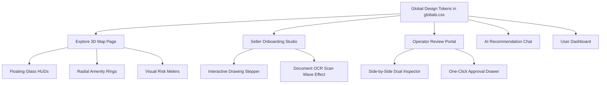

# NAQSHAI: Complete UI/UX Renovation Master Plan & Design Concepts

**Document Version:** 1.0  
**Project:** NAQSHAI — Cadastral AI & Geospatial Land Advisory  
**Target Design Standard:** Elite International PropTech (Linear / Stripe / Airbnb / Swiss Architectural tier)  
**Established Core Palette:** Refined Architectural Light (`#F8FAF8` canvas, `#FFFFFF` floating surfaces, `#065F46` / `#047857` deep emerald accents, `#D1D5DB` hairline borders)  

---

## 1. Executive Design Evaluation: Why the Current UI Feels "Mehh"

While the Home Page has strong cartographic topography watermarks and mascot personality, the core product pages suffer from common early-stage MVP symptoms:

1. **Utility-Tool Syndrome:** The Explore, Sell, and Review pages look like internal database administrative forms rather than a multi-million-rupee investor portal.
2. **Dense, Boxy Layouts:** Heavy rectangular borders (`border-slate-200`) and lack of elevation hierarchy create visual clutter.
3. **Flat Data Presentation:** High-value intelligence (e.g. 58 dB noise, flood runoff, 98% area match, CDA NOC status) is displayed as plain key-value text lines instead of visual telemetry meters, tactile badges, and interactive radial score rings.
4. **Disjointed Selling Experience:** The listing creation flow in `app/sell/` feels like a government tax form rather than a streamlined property onboarding studio.

---

## 2. Three Distinct Design Concepts (Pick Your Favorite)

Below are three curated design directions developed specifically for NAQSHAI. Each adheres to the **Refined Architectural Light** rule while offering a unique visual identity:

````carousel

<!-- slide -->

<!-- slide -->

````

---

### Concept 1: "Nordic Cadastral Minimalist" (Clean Architectural Luxury)
* **Visual Philosophy:** Swiss architectural minimalism meets precision Scandinavian cartography.
* **Key Characteristics:**
  - Crisp ultra-clean canvas (`#F8FAF9`) with pure white floating panels.
  - Generous whitespace, refined hairline borders (`border-slate-200/80`), and subtle depth blur (`backdrop-blur-md`).
  - **CDA Approval Stamp Badge:** Clean circular certification watermark on inspected listings.
  - **Visual Risk Meters:** Gradient spectrum bars (Green $\rightarrow$ Amber $\rightarrow$ Red) for Flood, Noise, and Subsidence indicators.
  - **Ideal For:** Sophisticated investors, diaspora buyers, and CDA/RDA planners who value clarity and minimalism.

---

### Concept 2: "Sovereign Spatial Intelligence" (High-Tech Cadastral Command)
* **Visual Philosophy:** Palantir / Bloomberg Terminal re-imagined with a bright, elegant architectural aesthetic.
* **Key Characteristics:**
  - Micro-topographical contour line backgrounds and survey grid lines.
  - **Acoustic Spectrum Gauge:** Live decibel bar graph visualizing daytime vs. nighttime noise levels (e.g., 57 dB vs. 53 dB).
  - **Geodesic Telemetry Card:** Tabular surface math breakdown converting square feet to Marla and Kanal in monospace typography.
  - **Floating HUD Layers:** Segmented toggle switches for Cadastral Grid, Topography, and 3D Buildings.
  - **Ideal For:** Highlighting NAQSHAI's deep engineering, geodesic math, and AI verification superiority.

---

### Concept 3: "Contemporary PropTech Studio" (Soft Luxury Modern)
* **Visual Philosophy:** High-end consumer tech (inspired by Apple, Airbnb, and Linear).
* **Key Characteristics:**
  - Pill-shaped tactile geometry (`rounded-3xl`), warm alabaster backgrounds, and rich drop shadows (`shadow-[0_12px_40px_rgb(0,0,0,0.06)]`).
  - **Radial Amenity Rings:** Circular progress dials displaying Education (8.5/10), Transit (8.7/10), and Commercial (8.1/10) scores.
  - **Prominent Direct Action Cards:** Rounded forest-green WhatsApp contact button with animated pulse indicator.
  - **High-Impact Property Showcase:** Rich card elevation with micro-zoom hover states on boundary polygons.
  - **Ideal For:** Consumer appeal, maximizing buyer conversion, and overseas Pakistani property transactions.

---

## 3. Design System Tokens: The New Visual Foundation

To implement any of these concepts, we upgrade NAQSHAI's design tokens in `app/globals.css`:

### A. Color Architecture
```css
:root {
  /* Canvas & Surfaces */
  --bg-canvas: #f7f9f7;          /* Softest architectural warm tint */
  --bg-surface: #ffffff;         /* Pure white elevation card */
  --bg-surface-subtle: #f0f4f1;  /* Soft sage/slate hover state */
  --bg-glass: rgba(255, 255, 255, 0.85); /* 85% Frosted Glassmorphism */

  /* Primary Brand (Sovereign Emerald) */
  --brand-primary: #047857;      /* Emerald 700 */
  --brand-hover: #065f46;        /* Emerald 800 */
  --brand-soft: #ecfdf5;         /* Emerald 50 (Badges, active states) */
  --brand-ring: rgba(4, 120, 87, 0.20);

  /* Secondary Accents */
  --accent-gold: #b45309;        /* Warm antique gold for premium certificates */
  --accent-gold-soft: #fef3c7;
  --accent-blue: #0284c7;        /* CDA Municipal zone highlight */
  
  /* Hairline Borders */
  --border-subtle: #e5e9e6;      /* Ultra-soft hairline border */
  --border-focus: #059669;

  /* Elevation Shadows (Multi-layer soft diffusion) */
  --shadow-card: 0 4px 20px -2px rgba(23, 58, 50, 0.05), 0 2px 6px -1px rgba(23, 58, 50, 0.03);
  --shadow-float: 0 20px 40px -10px rgba(23, 58, 50, 0.12), 0 8px 16px -4px rgba(23, 58, 50, 0.04);
}
```

### B. Typography Hierarchy
- **Display & Headings:** Geist Sans or Outfit (`tracking-tight`, font weights `600` and `700`).
- **Data & Telemetry:** Geist Mono (`font-mono`) for plot IDs, prices, coordinates, Marla conversions, and noise dB numbers.
- **Micro-Labels:** Uppercase `text-[10px] tracking-wider font-bold` for regulatory badges and status pills.

---

## 4. Page-by-Page Transformation Blueprint



### 1. Explore Page (`app/explore/page.js` & `components/explore/`)
* **Floating Glass Map Controls:** Replace flat grey buttons with frosted glass HUD controls (`backdrop-blur-md bg-white/90 shadow-float`).
* **Visual Risk Gauges:** Replace plain text `"Moderate Risk"` with horizontal gradient risk bars and decibel audio waves.
* **Radial Amenity Rings:** Replace plain distance lists with animated circular score meters (Education, Healthcare, Commercial, Transit).
* **CDA Verification Watermark:** Add an embossed verified seal on CDA/RDA approved listings.

### 2. Seller Onboarding Studio (`app/sell/page.js`)
* **Step-by-Step Luxury Studio Wizard:** Replace the traditional long form with a 5-step floating card studio.
* **Real-Time Boundary Feedback:** When drawing a polygon on the map, show a floating live pill:  
  `"10.2 Marla drawn (98.4% match with claimed 10 Marla) · CDA Standard Compliant"`
* **Animated Document Dropzone:** When dropping a CNIC or Allotment Letter, show a sleek scanning laser animation during upload.
* **Instant Phone Verification:** Clean modal with 6 individual digit input boxes and automatic paste detection.

### 3. Operator Review Portal (`app/review/page.js`)
* **Command Center Dual-Screen:** Left side shows the uploaded deed scan; right side shows the live satellite polygon overlay.
* **Instant Discrepancy Highlight:** Green checkmarks next to matching fields (e.g. Owner Name: `"Muhammad Hassan"` ✓, Plot #: `"45"` ✓), red flags next to discrepancies.
* **One-Click Decision Drawer:** Sticky bottom approval bar with instant feedback.

### 4. AI Recommendation Chat (`app/recommend/page.js`)
* **Interactive Property Cards:** Chatbot messages embed mini interactive map previews of suggested plots.
* **Speech Audio Waveform:** Animated audio visualizer when the AI advisor speaks in Urdu or English.
* **Smart Quick-Filter Prompts:** Floating pill buttons (e.g., *"Show CDA Zone 1 plots under 2 Crore"*, *"Plots with lowest flood risk in Rawalpindi"*).

### 5. User Dashboard (`app/dashboard/page.js`)
* **Listing Lifecycle Progression Bar:** Visual pipeline tracker showing `Draft` $\rightarrow$ `Under Review` $\rightarrow$ `AI Vision Verified` $\rightarrow$ `Live on 3D Map`.
* **Quick Stats Header:** Total saved plots, active listings, and total estimated portfolio value.

---

## 5. Recommended Implementation Phases

| Phase | Scope | Deliverables |
| :--- | :--- | :--- |
| **Phase 1: Token & Shell Setup** | `globals.css`, `Navbar.js` | Update palette, frosted glass classes, typography tokens, and header branding. |
| **Phase 2: Explore Map Renovation** | `components/explore/` | Implement floating HUD, radial amenity meters, and visual risk gradient bars. |
| **Phase 3: Seller Studio Redesign** | `app/sell/page.js` | 5-step card studio, live geodesic area pill, and drag-and-drop document upload zones. |
| **Phase 4: Dashboard & Review Portal** | `app/dashboard/`, `app/review/` | Lifecycle progression bars, dual inspection viewer, and clean data tables. |

---

## 6. Your Next Decision

Review the 3 design mockups above and pick your preferred visual direction:
1. **Concept 1:** Nordic Cadastral Minimalist (Clean, elegant, Swiss architectural)
2. **Concept 2:** Sovereign Spatial Intelligence (High-tech, data-dense command center)
3. **Concept 3:** Contemporary PropTech Studio (Soft modern luxury, rounded cards, radial dials)
4. **Hybrid:** A blend of Concept 1 (minimalist elegance) with Concept 3's radial amenity rings and WhatsApp action card.
